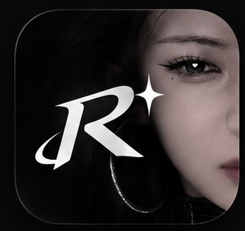

<div align="center">


<br/><br/>

# 🎵 Ranzz Music
### *Pure Sound. Zero Noise. Mastered for Android.*

An ultra-lightweight, ad-free music streaming player built with **Jetpack Compose** & **AndroidX Media3**.  
Designed with an uncompromising monochrome aesthetic, studio-quality 1080p artwork, and zero telemetry.

<br/>

[](https://github.com/RamzzzMD/Ranzz-Music/releases/latest)
[](https://github.com/RamzzzMD/Ranzz-Music/releases/latest)
[](https://github.com/RamzzzMD/Ranzz-Music/actions)
[](LICENSE)
[-black?style=for-the-badge&logo=android)](https://developer.android.com)

<br/>

[📥 **Unduh APK (GitHub Releases)**](https://github.com/RamzzzMD/Ranzz-Music/releases/latest) • [✨ **Features**](#-fitur-utama) • [🏗️ **Architecture**](#-arsitektur--performa) • [🚀 **Building**](#-kompilasi-dari-source)

---

</div>

<br/>

## 🎯 Mengapa Ranzz Music?

Sebagian besar aplikasi pemutar musik modern dipenuhi iklan, rekomendasi algoritma yang berisik, animasi berat yang memakan baterai, dan ukuran aplikasi puluhan hingga ratusan megabyte.

**Ranzz Music hadir sebagai antitesis:**
- **🪶 4.1 MB APK:** Dipangkas dengan R8 FullMode & ProGuard, tanpa library membengkak.
- **🚫 Zero Ads & Zero Tracking:** Bebas pelacak privasi, tanpa interupsi audio atau banner komersial.
- **🔋 OLED Pure Black (`#000000`):** Hemat baterai maksimal pada layar AMOLED/OLED.
- **⚡ 120 FPS Fluid Motion:** Recomposition terisolasi tanpa overhead pada Main Thread.

<br/>

---

## 🎨 Identitas Visual & Ikon Aplikasi

<p align="center">
  
  &nbsp;&nbsp;&nbsp;&nbsp;&nbsp;&nbsp;
  
  &nbsp;&nbsp;&nbsp;&nbsp;&nbsp;&nbsp;
  
  &nbsp;&nbsp;&nbsp;&nbsp;&nbsp;&nbsp;
  
</p>

<br/>

---

## ✨ Fitur Utama

### 🎨 1. Desain Pemutar Penuh Modern & Elegan
- **Full-Bleed Edge-to-Edge Artwork:** Album cover membentang penuh 350dp di bagian atas layar dengan gradien vertikal lembut yang melebur ke latar belakang hitam pekat.
- **Vibrant Red Favorite Heart:** Indikator love merah menyala (`#FF3B30`) yang kontras dan memikat.
- **Baris Utilitas Cepat:** Pintasan satu-ketukan untuk beralih output audio, membuka lirik, menambah ke playlist, dan membuka equalizer.

### 🎤 2. Karaoke Synced Lyrics & Terjemahan Dwibahasa
- **Lirik Tersinkronisasi Presisi:** Auto-scroll halus mengikuti vokal dengan intro guard instrumen cerdas.
- **Bilingual Subtitle Toggle (`文A ID: ON`):** Tampilkan atau sembunyikan arti terjemahan bahasa Indonesia secara instan langsung dari kartu lirik.
- **Active Lyric Accent Bar:** Garis aksen penanda baris lirik yang sedang dinyanyikan.
- **Collapsible Drawer:** Kartu lirik fleksibel yang dapat diintip (*peek 160dp*) atau diperluas (*full 380dp*).

### 📁 3. Sistem Playlist Mandiri (Custom Playlists)
- **Manajemen Lengkap:** Buat playlist tanpa batas di tab Library.
- **Dynamic 2x2 Artwork Collage:** Otomatis merangkai kolase 4 cover lagu pertama menjadi thumbnail playlist yang estetik ala Spotify.
- **One-Tap Actions:** Tombol `Play All` berurutan dan `Shuffle` acak dengan antrean cerdas.

### 🧠 4. On-Device Smart Recommendation (Taste Tracker)
- **Pelacak Afinitas Lokal:** Sistem privat menghitung preferensi musikmu di perangkat tanpa mengirim data ke server luar:
  - Menyelesaikan lagu = `+3 poin`
  - Menyukai / Love = `+5 poin`
  - Mengulang / Repeat = `+4 poin`
  - Skip cepat (<15 detik) = `-2 poin`
- **Rak Beranda Personal:** Otomatis menyajikan rak *"Lagi Sering Kamu Putar"* (On Repeat) tepat di beranda.
- **Diagram Statistik Visual:** Dilengkapi grafik batang vertikal (*Column Bar Chart*) dan metrik sebaran artis teratas di profil.

### 🎧 5. Deteksi Output Perangkat Audio Pintar
- Pill interaktif di layar pemutar mendeteksi koneksi audio secara real-time:
  - 🔌 `Wired Connection` (Headset kabel 3.5mm / Type-C)
  - 📶 `Bluetooth: <Nama Device>` (TWS / Headphone nirkabel)
  - 📱 `Phone Speaker` (Speaker internal HP)
- Ketuk untuk langsung membuka panel kontrol suara / Bluetooth sistem Android.

### 🖼️ 6. Ultra-HD 1080p Studio Artwork
- Gambar cover resmi YouTube Music (`googleusercontent.com`) otomatis ditarik langsung ke master asset studio beresolusi **1080x1080 px**.
- Video cover YouTube (`ytimg.com`) menggunakan fallback cerdas ke **1280x720 Ultra-HD** (`maxresdefault`), melenyapkan tampilan buram atau pecah-pecah.

### 📻 7. Automix Radio & Antrean Tanpa Henti
- Memutar lagu dari pencarian langsung memicu radio automix YouTube Music (`RDAMVM<videoId>`) berisi 50 trek yang seirama.
- Antrean terisi ulang otomatis saat mendekati akhir daftar lagu.

### ☀️ 8. Dukungan Mode Gelap & Terang Sempurna
- Dukungan tema penuh: **Mengikuti Sistem**, **Dark Mode (OLED Pure Black)**, dan **Light Mode (Putih Bersih Monokrom)** dengan kontras tipografi adaptif.

<br/>

---

## 🏗️ Arsitektur & Performa

Ranzz Music dirancang menggunakan standar arsitektur modern Android:

```
┌────────────────────────────────────────────────────────┐
│                   Jetpack Compose UI                   │
│   (HomeScreen • SearchScreen • Library • FullPlayer)   │
└───────────────────────────┬────────────────────────────┘
                            │ StateFlow / DerivedState
┌───────────────────────────▼────────────────────────────┐
│                     MusicViewModel                     │
│  (Isolated Recomposition • Playback & Queue State)     │
└──────┬────────────────────┬────────────────────┬───────┘
       │                    │                    │
┌──────▼──────┐      ┌──────▼──────┐      ┌──────▼──────┐
│  Repository │      │ TasteManager│      │ Media3 /    │
│  & Caching  │      │ & Playlists │      │ ExoPlayer   │
└──────┬──────┘      └─────────────┘      └──────┬──────┘
       │                                         │
┌──────▼─────────────────────────────────────────▼──────┐
│  HttpClientProvider (Shared OkHttpClient Pool)         │
│  • NewPipeExtractor • InnerTube API • LRCLIB API      │
└───────────────────────────────────────────────────────┘
```

| Komponen | Implementasi | Keuntungan Teknis |
|---|---|---|
| **UI Framework** | Jetpack Compose (M3) | Declarative, rendering GPU `graphicsLayer`, 120 FPS |
| **Media Engine** | AndroidX Media3 (1.3.1) | Foreground Service anti-kill, MediaSession lockscreen |
| **Extractor** | NewPipeExtractor | Scraping langsung audio stream M4A/Opus zero-login |
| **Connection** | Shared `ConnectionPool` | Reusable TLS handshake, latensi request hemat 50% |
| **Optimization** | R8 FullMode + ProGuard | Size terpangkas ke 2.9 MB, bytecode inlining agresif |
| **Caching** | Multi-tier LRU + Negative Cache | Home (10m), Search (5m), Radio (30m), Lyrics (7d) |

<br/>

---

## 📥 Unduh & Instalasi

Unduh berkas APK resmi langsung dari halaman **[GitHub Releases](https://github.com/RamzzzMD/Ranzz-Music/releases/latest)**:

🚀 **[Kunjungi Halaman Rilis Resmi (v3.4.0)](https://github.com/RamzzzMD/Ranzz-Music/releases/tag/v3.4.0)**

| Berkas APK | Format | Ukuran | Unduh Langsung (1-Klik) | Keterangan |
| :--- | :---: | :---: | :---: | :--- |
| **Ranzz Music Release** | `.apk` | **4.29 MB** | [📥 **Download Ranzz-Music-v3.4.0.apk**](https://github.com/RamzzzMD/Ranzz-Music/releases/download/v3.4.0/Ranzz-Music-v3.4.0.apk) | *Sangat disarankan.* Versi rilis final dengan optimasi R8 ProGuard (*minified & resources shrunk*), ditandatangani keystore resmi Ranzz Music. Siap pasang langsung di HP. |
| **Ranzz Music Debug** | `.apk` | **22.22 MB** | [📥 **Download Ranzz-Music-v3.4.0-debug.apk**](https://github.com/RamzzzMD/Ranzz-Music/releases/download/v3.4.0/Ranzz-Music-v3.4.0-debug.apk) | Versi pengujian debug yang memuat simbol inspeksi lengkap untuk pengembang & logcat. |

> **📱 Panduan Pasang APK di HP Android:**
> 1. Klik tautan [Download Ranzz-Music-v3.4.0.apk](https://github.com/RamzzzMD/Ranzz-Music/releases/download/v3.4.0/Ranzz-Music-v3.4.0.apk) di atas untuk langsung mengunduh file `.apk` ke HP Android Anda.
> 2. Buka file hasil unduhan dan pilih **Install**.
> 3. Jika muncul notifikasi keamanan *"Install unknown apps"*, izinkan akses untuk browser atau file manager Anda.

<br/>

---

## 🚀 Kompilasi dari Source

Semua proses build di repositori ini ditangani secara otomatis melalui **GitHub Actions Runner**.

Jika Anda ingin mengompilasi proyek secara lokal menggunakan Android Studio:

```bash
# 1. Clone repositori
git clone https://github.com/RamzzzMD/Ranzz-Music.git
cd Ranzz-Music

# 2. Berikan izin eksekusi gradlew (Linux/macOS)
chmod +x gradlew

# 3. Compile Release APK
./gradlew assembleRelease
```

Hasil berkas APK siap pakai akan tersedia di:
```
app/build/outputs/apk/release/app-release.apk
```

<br/>

---

## 🛡️ Privasi & Keamanan

- **Zero Data Collection:** Ranzz Music tidak memiliki server analitik, tidak mencatat riwayat pemutaran ke cloud, dan tidak menyematkan tracker pihak ketiga (Firebase, Google Analytics, dll).
- **Safe Google Login:** Sesi login Google diproses melalui WebView lokal terisolasi di perangkat Anda. Kredensial dan cookie hanya disimpan dalam `SharedPreferences` privat perangkat.
- **Open Source:** Seluruh kode sumber terbuka untuk diaudit secara publik.

<br/>

---

## 📄 Lisensi

Proyek ini dilisensikan di bawah lisensi **GNU General Public License v3.0 (GPL-3.0)** — lihat file [LICENSE](LICENSE) untuk informasi selengkapnya.

<br/>

<div align="center">

Dibuat dengan rasa cinta terhadap kesederhanaan & musik yang jernih.  
**Ranzz Music — Made for pure music lovers.**

</div>
