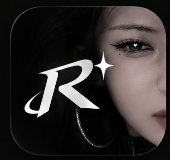

<div align="center">


<br/><br/>

# 🎵 Ranzz Music
### *Pure Sound. Zero Noise. Mastered for Android.*

An ultra-lightweight, ad-free music streaming player built with **Jetpack Compose**, **AndroidX Media3**, & **Rust Native Core (`ranzz-core`)**.  
Designed with an uncompromising monochrome & dynamic palette aesthetic, studio-quality artwork, LiriQo multi-source karaoke lyrics, offline playback, and zero telemetry.

<br/>

[](https://github.com/RamzzzMD/Ranzz-Music/releases/latest)
[](https://github.com/RamzzzMD/Ranzz-Music/actions)
[](LICENSE)
[-black?style=for-the-badge&logo=android)](https://developer.android.com)

<br/>

[📥 **Unduh APK (GitHub Releases)**](https://github.com/RamzzzMD/Ranzz-Music/releases/latest) • [🆕 **Changelog v3.9.8**](#-apa-yang-baru-di-v398) • [✨ **Features**](#-fitur-utama) • [🏗️ **Architecture**](#-arsitektur--performa) • [🚀 **Building**](#-kompilasi-dari-source)

---

</div>

<br/>

## 🆕 Apa yang Baru di v3.9.8

Pembaruan **Ranzz Music v3.9.8** menghadirkan peningkatan besar pada pemutaran offline, tab eksplorasi Vibe, komentar lagu, dukungan 12 bahasa, optimasi performa jaringan & memori, serta pengerasan mesin native Rust (`ranzz-core`):

- **📥 Offline Audio & Thumbnails (`OfflineMusicManager`)**
  - ExoPlayer cache data source dibungkus dengan `DefaultDataSource.Factory` sehingga pemutaran file lokal (`file://` dan `content://`) berjalan mulus tanpa internet.
  - Menyimpan audio kualitas tinggi dan sampul album offline secara lokal, mempertahankan MIME type, serta pemulihan sesi offline otomatis.
- **✨ Tab Vibe, Playlist Detail & Komentar Lagu**
  - **Vibe Screen**: Jelajahi musik berdasarkan suasana hati, energi, dan genre secara instan.
  - **Playlist Detail Sheet & Comments Bottom Sheet**: Lihat isi playlist secara detail serta baca/kirim komentar lagu langsung dari layar pemutar.
  - **Edit Profile**: Tetap mendukung kustomisasi foto profil (galeri/URL) & nama tampilan.
- **🌍 Dukungan 12 Bahasa & Cache Instan**
  - Tersedia dalam 12 bahasa: English, Bahasa Indonesia, 日本語, 한국어, 中文, Español, Français, Deutsch, Português, Русский, dan العربية.
  - Dilengkapi `UiStateCache` dan `HistoryStore` untuk startup cepat dan riwayat pemutaran yang presisi.
- **🦀 Peningkatan Mesin Native Rust (`ranzz-core`) & LiriQo**
  - Penanganan JNI exception yang lebih aman, deserialisasi respons LiriQo yang lebih tangguh, perbaikan peringkat penyedia lirik, serta parsing LRC multi-timestamp & offset.
  - Peningkatan sanitasi durasi, judul lagu, dan thumbnail di Rust.
- **⚡ Optimasi Performa & Split APK Per-ABI**
  - Menyatukan seluruh OkHttp client ke satu `ConnectionPool` dan `Dispatcher` bersama (`HttpClientProvider.baseClient`).
  - Polling pemutaran adaptif (100ms saat layar penuh / 500ms saat mini), pemindahan startup disk I/O dari main thread, serta dukungan build split APK (`arm64-v8a`, `armeabi-v7a`, dan Universal).
  - Perbaikan kritis pada *Add to Playlist*, tombol Share, auto-scroll lirik layar penuh, swipe antrean, serta aturan ProGuard/R8 & `MediaSessionService` Android 13–14.

<br/>

---

## 🎯 Mengapa Ranzz Music?

Sebagian besar aplikasi pemutar musik modern dipenuhi iklan, pelacak privasi, animasi berat yang menguras baterai, dan ukuran aplikasi puluhan hingga ratusan megabyte.

**Ranzz Music hadir sebagai antitesis:**
- **🦀 Rust-Powered & R8 Optimized:** Mesin inti ditulis dengan Rust (`ranzz-core`) + dipangkas dengan R8 FullMode, ProGuard, dan per-ABI split APK.
- **🚫 Zero Ads & Zero Tracking:** Bebas pelacak privasi, tanpa interupsi audio atau banner komersial.
- **🔋 OLED Pure Black (`#000000`) & Dynamic Palette:** Hemat baterai maksimal pada layar AMOLED/OLED dengan aksen warna sampul album yang elegan.
- **⚡ 120 FPS Fluid Motion:** Recomposition terisolasi tanpa overhead pada Main Thread.

<br/>

---

## 🎨 Identitas Visual & Ikon Aplikasi

<p align="center">
  
  &nbsp;&nbsp;&nbsp;&nbsp;&nbsp;&nbsp;
  
  &nbsp;&nbsp;&nbsp;&nbsp;&nbsp;&nbsp;
  
  &nbsp;&nbsp;&nbsp;&nbsp;&nbsp;&nbsp;
  
</p>

<br/>

---

## ✨ Fitur Utama

### 🎨 1. Desain Pemutar Penuh Modern & Dynamic Palette
- **Full-Bleed Edge-to-Edge Artwork & Swipe Gesture:** Album cover membentang penuh dengan dukungan *swipe* kiri/kanan untuk berpindah lagu dan gradien vertikal dinamis yang menyatu dengan warna sampul.
- **Quick Actions & Komentar:** Pintasan satu-ketukan untuk menyimpan favorit, mengunduh offline, membaca/menulis komentar, beralih output audio, membuka lirik layar penuh, mengatur antrean, *sleep timer*, dan kecepatan putar.

### 🎤 2. LiriQo Multi-Source Karaoke Lyrics & Terjemahan
- **Multi-Sumber Lirik Paralel:** Mengambil lirik tersinkronisasi dari berbagai penyedia dengan pencocokan durasi & metadata yang presisi.
- **Syllable / Word-by-Word Karaoke Sync:** Dukungan lirik karaoke per kata/suku kata dengan animasi sorotan progresif dan terjemahan lirik bawaan.

### 📱 3. Android Homescreen Widgets (`RanzzWidgets`)
- **Ranzz Compact Widget (4×1)** & **Ranzz Square Widget (2×2)** dengan kontrol Play/Pause, Next, Previous, Favorite, Repeat, dan sinkronisasi real-time.

### 🔐 4. Sinkronisasi Akun Google / YouTube Music & Kustomisasi Profil
- Login aman melalui WebView terisolasi untuk menyinkronkan lagu favorit, playlist, komentar, dan rekomendasi personal.
- Tetap mendukung kustomisasi foto profil & nama tampilan langsung dari `EditProfileDialog`.

---

## 🏗️ Arsitektur & Performa

Ranzz Music dibangun dengan arsitektur modern Android + Rust:

- **UI Layer:** Jetpack Compose + Material 3 + Dynamic Palette (`androidx.palette`)
- **Playback Engine:** AndroidX Media3 (`ExoPlayer`, `MediaSessionService`, `OkHttpDataSource`, `SimpleCache`)
- **Native Core (`ranzz-core`):** Rust JNI library (`libranzz_core.so`) untuk parsing InnerTube, LiriQo lyrics, sanitasi judul, dan payload penerjemah
- **Networking:** OkHttp shared `ConnectionPool` & `Dispatcher`, NewPipeExtractor, dan Coil image loader
- **Auto Updater:** `UpdateManager` terintegrasi dengan [GitHub Releases](https://github.com/RamzzzMD/Ranzz-Music/releases/latest) dengan pemilihan APK otomatis sesuai arsitektur ABI perangkat

---

## 📥 Instalasi

Unduh berkas APK resmi dari halaman [GitHub Releases](https://github.com/RamzzzMD/Ranzz-Music/releases/latest):

| Varian APK | Keterangan |
|---|---|
| `Ranzz-Music-v3.9.8-arm64-v8a.apk` | *Disarankan untuk mayoritas HP Android modern (64-bit).* Ukuran paling ringkas. |
| `Ranzz-Music-v3.9.8-armeabi-v7a.apk` | Untuk perangkat Android 32-bit lama. |
| `Ranzz-Music-v3.9.8-release.apk` | Universal Release APK (mendukung semua ABI). |
| `Ranzz-Music-v3.9.8-debug.apk` | Varian Debug untuk pengujian dan pengembangan. |

---

## 🚀 Kompilasi dari Source

### Prasyarat
- JDK 17
- Android SDK (API 34) & NDK
- Rust toolchain (`aarch64-linux-android`, `armv7-linux-androideabi`) & `cargo-ndk`

### Langkah Build
```bash
git clone https://github.com/RamzzzMD/Ranzz-Music.git
cd Ranzz-Music

# 1. Build native Rust core (ranzz-core)
cargo ndk -t arm64-v8a -t armeabi-v7a -o app/src/main/jniLibs build --release --manifest-path ranzz-core/Cargo.toml

# 2. Build Android Release APK
./gradlew assembleRelease
```

---

## 🔒 Privasi
- **Zero Data Collection:** Ranzz Music tidak memiliki server analitik, tidak mengumpulkan telemetri, dan tidak menyematkan tracker pihak ketiga.
- Seluruh preferensi, riwayat lokal, unduhan offline, dan playlist tersimpan lokal di perangkat Anda.

---

<div align="center">

**Ranzz Music — Pure Sound. Zero Noise.**

</div>
